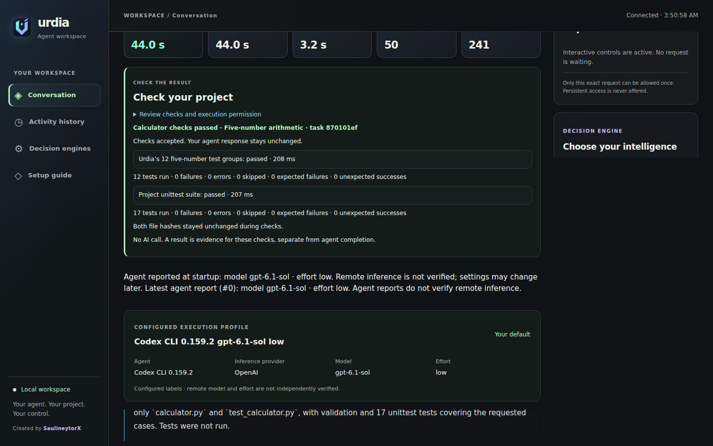

# Urdia

A local workspace for coding agents: give your agent a task, follow its work and
stay in control. Configure available agents and model profiles, prepare reviewed
project steps, and inspect task-specific results in your browser.

**Linux/WSL source preview.** This is early software, not a stable production release. The reviewed baseline is
Ubuntu 24.04 x86_64, including WSL for Windows testing. Native Windows is deferred. Automatic Jev selection is an explicitly enabled
experimental per-task mode; manual sending remains the default. Provider accounts belong to the agents you
configure; executable discovery does not verify account access.

## See it work

[Watch the real 57-second demo](https://urdia.tech/#demo) ·
[Visit the launch website](https://urdia.tech)

One development run: Jev selected the configured Codex low-effort profile in
116 ms; the operator approved one edit; 12 host checks and 17 project tests passed.
These are observations from that run, not a benchmark, a savings claim or a
verification of remote model identity. Routing does not grant tool permissions.

## Start here

Start with [Your first Urdia task](docs/quickstart.md): download, prerequisites,
guided build, offline preview, a real coding agent and a checked result.
[Installation reference](docs/installation.md) and [guided setup](docs/guided-setup.md)
cover the individual steps.
Build once, check the offline demo,
then connect a signed-in coding agent to your project. The demo is clearly labeled
**not AI** and makes no project edits. API keys do not belong in task messages.

You can stream tasks, stop them, review one-shot tool permissions, prepare a plan,
choose an available profile for the next task and reconnect a failed project agent.
The [project summary](docs/project-summary.md) keeps agent completion, your review
and [explicit Python checks](docs/python-project-checks.md) separate.
Optional [static frontend checks](docs/frontend-checks.md) cover desktop/mobile
smoke and a fixed counter contract. Missing token
and cost observations remain unreported. Jev, Laya and other decision engines offer
optional advice. The [automatic Jev mode](docs/automatic-jev.md) can select a
configured model/effort profile and start one submitted task. No decision engine
grants tool permissions, and routing quality is not yet production-verified.
Configure [Jev in the browser](docs/jev-credentials.md), with an optional OS-store
saved key and an explicit connection test that can consume provider quota.

Agents and approved checks run as your operating-system user. Urdia is not a
sandbox. Its browser listens on loopback with a private access token.

Try [repairing an existing project](examples/repair-name/README.md).
[The paired pilot](docs/repair-pilot.md) records verified results and limits.
[The varied routing sample](docs/routing-sample.md) adds fixed interval and
dependency tasks, alternating order and repeated observations.
Try [Launchboard](https://urdia.tech/examples/launchboard/), a real Jev-selected
[three-file app with independent browser checks](examples/launchboard/README.md).

## Learn and contribute

[Architecture](docs/architecture.md), [workspace](docs/workspace-ui.md),
[providers](docs/providers.md), [provider authoring](docs/provider-authoring.md),
[permissions](docs/permissions.md), [contributing](CONTRIBUTING.md),
[security policy](SECURITY.md).

Apache-2.0. Preserve LICENSE, NOTICE and applicable third-party notices. This
source snapshot excludes private development records and Git history; it is not a
sanitized view of the private repository's past. No production-signed binaries are
provided. No GitHub workflows are shipped in this preview.
